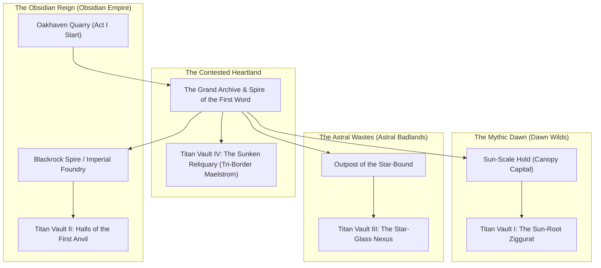

# World Geography, Regions & The Four Titan Vaults

## 1. The Continent of Vaelora

Vaelora is a single interconnected high-fantasy continent where three neighboring superpowers surround the central crater of the shattered **Edict Pillar**.

---

## 2. Act I Region: The Frontier Borderlands

### Oakhaven & The Shattered Quarry
* **Territory:** Border frontier between **The Obsidian Reign** and **The Mythic Dawn**.
* **Visual Aesthetic:** Timber-and-basalt mason guildhalls, terraced stone quarries, crane lifts, and glowing boundary Wardstones overlooking the encroaching jungle canopy to the west.
* **Key Locations:**
  * **Oakhaven Masons' Guild:** Kaelen and Master Orin's home base; houses the first Blacksmith Forge.
  * **The Cratered Quarry (Dungeon 1):** Where the **Heart-Shard** fell from the sky. Half the quarry is crystallized in volatile rune-shards (where Master Orin stands petrified), while the lower tunnels are overrun by frenzied Dawn-beasts and Imperial Inquisitor scouts.
  * **The Kingsroad Pass (Dungeon 2):** Ancient canyon highway leading from Oakhaven to the **Grand Archive**, featuring the first dormant **Titan Waygate** and local **Wardstone Attunement** bridge puzzles.
* **Act I Bosses:**
  * **Crystal-Gorged Basilisk:** A quarry beast mutated by eating fragments of the fallen Heart-Shard.
  * **Inquisitor Vane & Ironclad Hound-Pack:** Imperial vanguard sent to confiscate Kaelen's gauntlet at the border gate.

---

## 3. Central Hub: The Grand Archive

* **Location:** Built around the rim of the **Covenant Crater** at the center of the continent where all three borders meet.
* **Visual Aesthetic:** Towering white marble and obsidian libraries, floating celestial astrolabes, and ancient Titan murals depicting the carving of the Edict Pillar.
* **Hub Features:**
  * **The Central Waygate Plaza:** Connects to all discovered **Titan Waygates** across the three territories.
  * **The Hall of Rubbings:** Where **Vesper** and **Cassian** decipher Titan tablets and track collected **Glyphs**.
  * **The Tri-Realm Envoy Quarter:** Houses merchants, bounty boards, and blacksmiths from the Dawn, Reign, and Wastes.

---

## 4. Act II: The Three Superpowers & The Four Ancient Titan Vaults

In Act II, none of the three superpowers possess the **Four Great Shards** yet—the shards crashed into four ancient, sealed **Titan Vaults**. Because only Kaelen's **Heart-Shard Gauntlet** can unseal the inner vault doors, each region is a three-way race through warzones and Titan dungeons.

### 1. The Mythic Dawn & *The Sun-Root Ziggurat* (Vault I)
* **Region Aesthetic:** Colossal emerald trees the size of mountains, golden stone temples draped in flowering lianas, sky-bridges patrolled by Sun-Scale wyvern riders.
* **Hub Town:** **Sun-Scale Hold** — Built into the upper boughs of a hollow Great-Tree; home to Sura's clan and the Wyvern Roosts (where the party earns their **Sun-Drake** mounts).
* **Dungeon (Titan Vault I): *The Sun-Root Ziggurat***
  * **Wardstone Mechanic:** Channeling **Dawn** energy grows giant sun-vine bridges across sunlit shafts; channeling **Obsidian** energy petrifies carnivorous thorn-walls so Kaelen's maul can shatter them.
  * **Mid-Boss:** **Warlord Raksha of the Sun-Scales** — Sura's former mentor, who tries to seize the Dawn Great Shard at the temple steps to burn the Obsidian Empire to ash.
  * **Vault Guardian Boss:** **Aurelius, the Solar Colossus** — A golden Titan construct overgrown with living jungle wood.
    * *Domain Puzzle:* Aurelius regenerates massive HP while the arena is in the **Mythic Dawn** domain. Striking the Heart-Shard to shift the battlefield into **The Obsidian Reign** or **The Astral Wastes** severs its solar photosynthesis and exposes its core.

### 2. The Obsidian Reign & *Halls of the First Anvil* (Vault II)
* **Region Aesthetic:** Jagged volcanic peaks, rivers of liquid magma, monumental blackrock fortresses, and roaring dark-iron foundries.
* **Hub Town:** **Cinderhold / The Iron Bastion** — A tiered fortress-city carved into a volcanic caldera; home to the continent's greatest Master Blacksmiths and Cassian's former Inquisitorial Academy.
* **Dungeon (Titan Vault II): *Halls of the First Anvil***
  * **Wardstone Mechanic:** Channeling **Obsidian** energy activates magma floodgates and forge-pistons; channeling **Astral** energy freezes lava falls into climbable starlight glass.
  * **Mid-Boss:** **Forge-Lord Malakor** — Commander of the Imperial Dread-Legions racing to bind the Great Shard into his war-machines.
  * **Vault Guardian Boss:** **Ignis-Prime, The World-Forger** — A four-armed Titan smith-golem wielding a molten anvil-hammer.
    * *Domain Puzzle:* Ignis-Prime's molten armor grants it double Stability in the **Obsidian Reign** domain. Shifting the arena into **The Astral Wastes** flash-cools its armor with void-frost, allowing Kaelen to **Shatter** it in a single combo.

### 3. The Astral Wastes & *The Star-Glass Nexus* (Vault III)
* **Region Aesthetic:** Endless dunes of stark white sand, floating violet/cyan crystal monoliths, gravity anomalies, and aurora-lit night skies.
* **Hub Town:** **The Star-Bound Conclave (Mirage Sanctum)** — An oasis settlement of Ethereal scholars, mana-smiths, and nomadic star-seers anchored beneath a floating crystal dome.
* **Dungeon (Titan Vault III): *The Star-Glass Nexus***
  * **Wardstone Mechanic:** Channeling **Astral** energy reverses gravity and links floating crystal islands; channeling **Dawn** energy grounds volatile arcane storms with living roots.
  * **Mid-Boss:** **Nexus-Prince Xylar** — Leader of the rogue Astral Conclave who seeks the Great Shard to ascend into pure arcane light.
  * **Vault Guardian Boss:** **Algalon-Vex, The Constellation Watcher** — A celestial Titan construct that manipulates the CTB Timeline bar directly.
    * *Domain Puzzle:* Places lethal *Supernova* hazard slots on the CTB bar while in the **Astral Wastes** domain. Shifting the arena to **The Mythic Dawn** or **Obsidian Reign** grounds its gravity field and locks its turn portrait in place.

### 4. The Contested Tri-Border & *The Sunken Reliquary* (Vault IV)
* **Region Aesthetic:** A massive, swirling canyon maelstrom where the jungle rivers of the Dawn, the basalt cliffs of the Reign, and the crystal reefs of the Wastes collide.
* **Dungeon (Titan Vault IV): *The Sunken Reliquary***
  * **The Four-Way Clash:** Unlike the first three vaults, armies from all three superpowers arrive simultaneously at the Sunken Reliquary. The dungeon features dynamic multi-faction skirmishes where Dawn Wyverns, Obsidian Golems, and Astral Arcanists are fighting each other in the halls while your party pushes toward the inner sanctum.
  * **Vault Guardian Boss:** **The Covenant Arbiter** — A three-faced Titan judge that rotates between **Dawn**, **Obsidian**, and **Astral** affinities every time it is **Shattered**, testing the party's mastery of all three Ley-Line Domain Shifts.

---

## 5. Act III Endgame Dungeon: *The Spire of the First Word*

* **Location:** Rises out of the shattered crater of the **Grand Archive** after **High Archon Seraphine Thorne** betrays the party and unites the Four Great Shards.
* **Structure:** A vertical ascent through three corrupted wings representing the enslaved realms (*The Calcified Canopy*, *The Chained Foundry*, and *The Frozen Stars*), where the **Tri-Realm Coalition** allies you rallied across the continent hold off Seraphine's armies to clear your path to the summit.
* **Final Boss:** **High Archon Seraphine, Avatar of the New Covenant** — A multi-phase battle where Seraphine attempts to overwrite the combat rules themselves with Divine Edicts, culminating in Kaelen using the **Heart-Shard Gauntlet** to shatter the Pillar forever.
